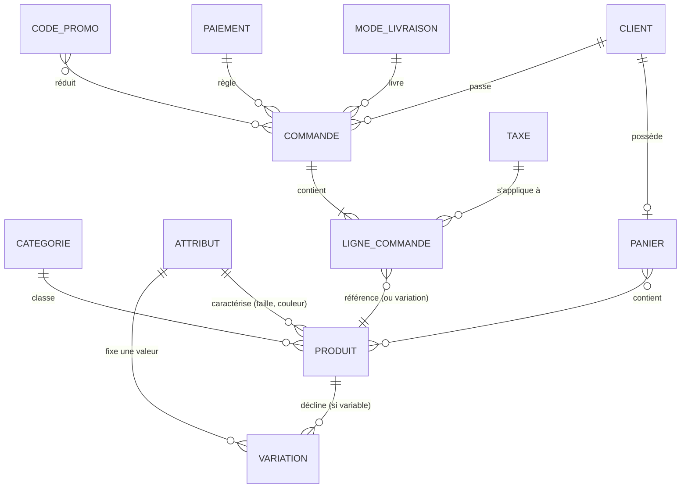
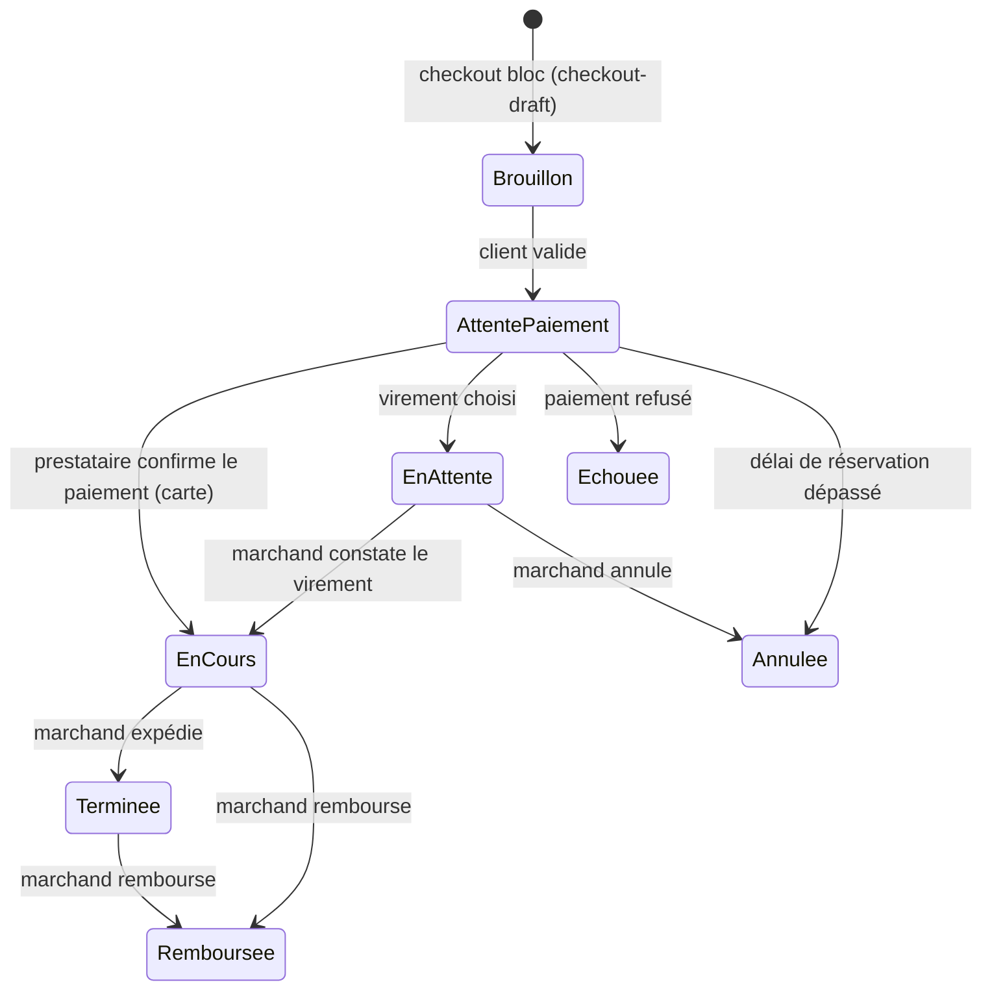

# Note de cadrage — Culture Vélib

*Magasin-atelier de vélos fictif à Strasbourg. Groupe : NOM 1, NOM 2, NOM 3.*

## 1. Ce qu'un CMS fait à notre place

Au projet précédent (Strapi + React + Flutter, boutique « Étoffe »), on a modélisé à la main
`produit`, `category`, `panier` et `commande`. Notre `produit` n'avait **ni prix, ni stock, ni
variante**, et les lignes de commande étaient un simple champ `json`. Tout le reste manquait.

| Besoin | Strapi + Flutter (fait main) | WordPress + WooCommerce (fourni) |
|---|---|---|
| Back-office, comptes, rôles | Admin Strapi, mais rôles et permissions API à régler un par un | Tableau de bord, rôles *Gestionnaire de boutique* / *Client*, mot de passe oublié |
| Catalogue | Content-types écrits nous-mêmes, sans prix ni stock | Produits simples / variables, attributs, UGS, stock, rupture, promo datée |
| Panier | Content-type `panier` lié à un seul produit, état dans un `CartContext` côté client | Panier en session serveur, jeton `Cart-Token`, mini-panier |
| Commande | Champ `statut` à 4 valeurs, aucun calcul | Cycle de statuts, totaux, remboursements, notes, e-mails |
| TVA, livraison, paiement | Rien | Taux par zone, prix TTC, zones de livraison, passerelles (virement, Stripe…) |
| Médias | Upload Strapi | Médiathèque avec redimensionnement et texte alternatif |
| Pages, SEO, design | Front React codé de zéro | Éditeur de site en blocs, thème, pages, menus |
| API | REST générée, à sécuriser | Store API publique (panier/checkout) + REST v3 authentifiée |

**Deux limites du CMS.**
1. **Le modèle est imposé** : tout passe par `wp_posts`/`wp_postmeta` (clé-valeur) ; un besoin
   métier hors norme (location de vélos à la journée, réservation d'un créneau d'atelier) demande
   une extension payante ou du code PHP, et on hérite de leurs choix.
2. **Surface d'attaque et maintenance** : cœur + WooCommerce + extensions = des mises à jour
   chaque mois ; chaque extension ajoutée est du code tiers qu'on exécute sur le serveur.

## 2. Le modèle de données d'un commerce

| Objet | Où dans WordPress (avec HPOS, stockage des commandes par défaut) |
|---|---|
| Produit | `wp_posts` (`post_type = product`) + `wp_postmeta` (`_price`, `_sku`, `_stock`…) + `wp_wc_product_meta_lookup` (index) |
| Variation | `wp_posts` (`post_type = product_variation`, `post_parent` = le produit) + `wp_postmeta` |
| Catégorie | `wp_terms` + `wp_term_taxonomy` (`taxonomy = product_cat`) + `wp_term_relationships` |
| Attribut | `wp_woocommerce_attribute_taxonomies` (définition) ; valeurs = termes de la taxonomie `pa_taille`, `pa_couleur` |
| Client | `wp_users` + `wp_usermeta` (adresses `billing_*`) + `wp_wc_customer_lookup` |
| Panier | `wp_woocommerce_sessions` (invité ou connecté) ; panier persistant dans `wp_usermeta` |
| Commande | `wp_wc_orders` + `wp_wc_order_addresses` + `wp_wc_order_operational_data` |
| Ligne de commande | `wp_woocommerce_order_items` (type `line_item`, `shipping`, `tax`, `coupon`) + `wp_woocommerce_order_itemmeta` |
| Taxe | `wp_woocommerce_tax_rates` + `wp_woocommerce_tax_rate_locations` |
| Mode de livraison | `wp_woocommerce_shipping_zones`, `_zone_locations`, `_zone_methods` ; réglages dans `wp_options` |
| Paiement | Réglages de la passerelle dans `wp_options` (`woocommerce_bacs_settings`…) ; sur la commande : `payment_method`, `transaction_id` |
| Code promo | `wp_posts` (`post_type = shop_coupon`) + `wp_postmeta` (montant, restrictions, nombre d'usages) |

## 3. Le cycle de vie d'une commande

| Statut | Qui le déclenche | Stock |
|---|---|---|
| Brouillon (`checkout-draft`) | Le client arrive sur la page de commande | Réservé temporairement (`wp_wc_reserved_stock`, quelques minutes) |
| Attente paiement (`pending`) | Le client valide la commande | Pas encore décrémenté |
| En attente (`on-hold`) | Automatique quand le client choisit le virement | **Décrémenté** |
| En cours (`processing`) | Le **prestataire de paiement** (Stripe, par webhook) | **Décrémenté** (une seule fois, drapeau `order_stock_reduced`) |
| Terminée (`completed`) | Le **marchand**, à l'expédition ou au retrait en magasin | Inchangé |
| Échouée (`failed`) | Le prestataire | Non décrémenté |
| Annulée (`cancelled`) | Le marchand, ou WooCommerce si non payée après le délai « Conserver le stock » | **Réincrémenté** si déjà décrémenté |
| Remboursée (`refunded`) | Le marchand | Réincrémenté si la case « Remettre en stock » est cochée |

Chaque changement envoie un e-mail (client et/ou marchand) et ajoute une note à la commande.

## 4. Notre arbitrage : WooCommerce

Pour Culture Vélib (une trentaine de références, un vendeur, ventes surtout locales), **WooCommerce**.

1. **Délai.** Notre boutique Strapi n'avait après plusieurs semaines ni prix, ni stock, ni TVA, ni
   paiement. Avec WooCommerce, catalogue, TVA, livraison, paiement test et e-mails tiennent en
   environ **4 semaines à temps partiel** (le planning de ce projet). En sur-mesure, il faudrait
   recoder TVA, frais de port, passerelle, e-mails et back-office : une estimation prudente de
   **30 jours-homme**, soit ~**12 000 €** à 400 €/jour.
2. **Coût récurrent.** WordPress et WooCommerce sont gratuits (GPL). Un hébergement mutualisé
   coûte **5 à 10 € par mois** ; Stripe prend **1,5 % + 0,25 €** par carte européenne, sans
   abonnement. Le sur-mesure demande un hébergement Node + base + stockage d'images, et un
   développeur pour chaque évolution.
3. **Maintenance et dépendances.** WooCommerce est maintenu par Automattic, publie des versions
   chaque mois et compte plusieurs millions d'installations actives (vérifiable sur
   `wordpress.org/plugins/woocommerce`) : les failles sont trouvées et corrigées vite, et le
   commerçant peut se faire aider par n'importe quelle agence. En contrepartie, on dépend de ses
   choix (prix de certaines extensions, ruptures de compatibilité lors des mises à jour majeures).

**Quand changerait-on d'avis ?** Si le client voulait la location de vélos à l'heure avec caution
et créneaux, ou un configurateur de vélo sur-mesure : là, le cœur métier sort du cadre de
WooCommerce et le sur-mesure (ou une API dédiée branchée sur WooCommerce) se justifie.
