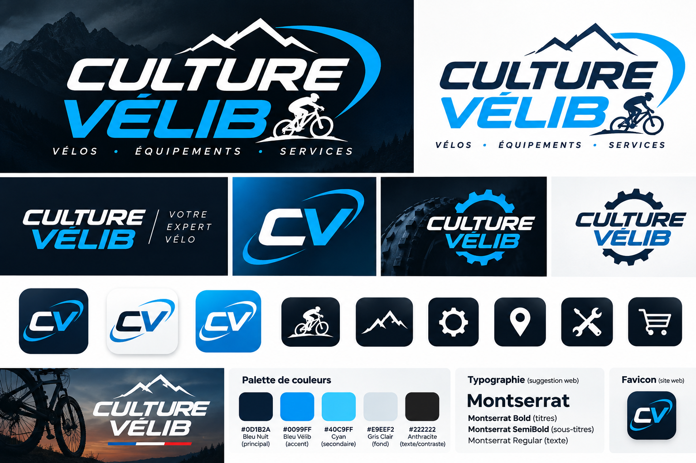

# Charte — Culture Vélib

> Client fictif, projet pédagogique. Nom, adresse, e-mails et SIRET sont inventés.
> Aucune affiliation avec Culture Vélo ni avec Vélib' Métropole.

**Culture Vélib** est un magasin-atelier de vélos en bord de Loire, à Orléans (fictif : 8 quai du
Châtelet, 45000 Orléans). On y vend des vélos de ville, électriques, cargos et gravels, des
équipements, et on y répare tout ce qui roule. La clientèle : les gens qui vont au travail à vélo,
les familles, et ceux qui partent le week-end sur la Loire à Vélo ou en Sologne.

Slogan : **« Vélos · Équipements · Services »**, et dans l'en-tête sombre : **« Votre expert vélo »**.

## Logos

Le kit complet est dans [`kit/`](kit/LISEZ-MOI.txt) (planche, PNG, SVG, icônes).

| Fichier | Usage sur le site |
|---|---|
| [`web/logo-principal-transparent.png`](web/logo-principal-transparent.png) | Bloc *Logo du site* (en-tête), bannière d'accueil, en-tête des e-mails WooCommerce. Détouré depuis `kit/02_logos_png/logo_principal_fond_clair.png` (le PNG d'origine a un fond blanc cassé). |
| [`kit/03_logos_svg/logo_horizontal_sombre.svg`](kit/03_logos_svg/logo_horizontal_sombre.svg) | Pied de page bleu nuit, inséré en SVG pour rester net et prendre la police Montserrat du thème. |
| [`web/icone-cv.png`](web/icone-cv.png) | Icône du site (favicon), monogramme CV aux coins transparents. |
| `web/icone-velo.png`, `icone-boutique.png`, `icone-atelier.png` | Cartes des trois rayons sur l'accueil. |

WordPress refuse les SVG dans la médiathèque : le site utilise donc les PNG, et les SVG servent aux
documents et au pied de page.

## Couleurs

| Rôle | Nom | Code | Usage |
|---|---|---|---|
| Principale | Bleu nuit | `#0D1B2A` | Texte, titres, boutons, en-tête des e-mails, bandeau et pied de page |
| Accent | Bleu Vélib | `#0099FF` | « VÉLIB » du logo, liseré de l'en-tête, gros titres, bouton principal de la bannière |
| Secondaire | Cyan | `#40C9FF` | Chiffres et titres sur fond bleu nuit |
| Fond | Gris clair | `#E9EEF2` | Bannière, cartes, fond des e-mails |
| Texte / contraste | Anthracite | `#222222` | Texte sur fond clair si besoin |
| *Dérivée* | Bleu lien | `#0077CC` | Liens et prix : le bleu Vélib n'est pas assez contrasté sur blanc |

**Contrastes calculés (WCAG 2.1)** et décisions qui en découlent :

| Combinaison | Ratio | Décision |
|---|---|---|
| Blanc sur bleu nuit | 17,4:1 | Boutons par défaut |
| Bleu nuit sur bleu Vélib | 5,8:1 | Bouton principal et survol des boutons (texte bleu nuit, jamais blanc) |
| Blanc sur bleu Vélib | 3,0:1 | **Évité** pour du texte : sous le seuil AA de 4,5:1 |
| Bleu Vélib sur blanc | 3,0:1 | Seulement pour les très gros titres (seuil 3:1) |
| Bleu Vélib sur gris clair | 2,6:1 | **Évité** : remplacé par le bleu lien `#0077CC` (prix sur les cartes) |
| Bleu lien sur blanc | 4,7:1 | Liens dans le texte |
| Cyan sur bleu nuit | 9,1:1 | Titres et chiffres du pied de page et du bandeau de réassurance |

## Typographie

**Montserrat** (licence SIL OFL), embarquée dans le thème : aucun appel à Google Fonts, donc aucune
donnée de visiteur envoyée à un tiers.

| Usage | Graisse | Style |
|---|---|---|
| H1, H2, menu, prix | 800–900 | Italique, majuscules : rappel du logo |
| Titres H3 et suivants | 700 | Droit |
| Texte courant | 400 | Droit |

## Ton

**Tutoiement** sur le site, direct et chaleureux, comme au comptoir de l'atelier : « Ton expert vélo à
Orléans ». Le logo garde sa signature d'origine, « Votre expert vélo ».

- Oui : « Ton vélo mérite une révision avant l'hiver. On s'en occupe en 48 h. »
- Non : « Profitez de notre offre exceptionnelle de maintenance premium ! »
